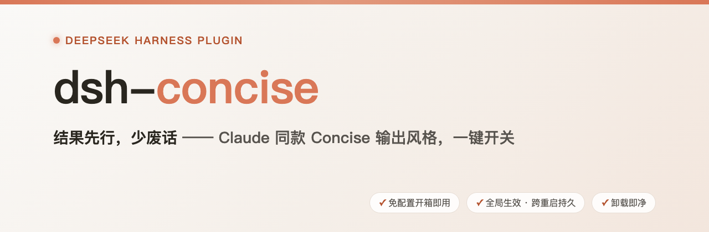
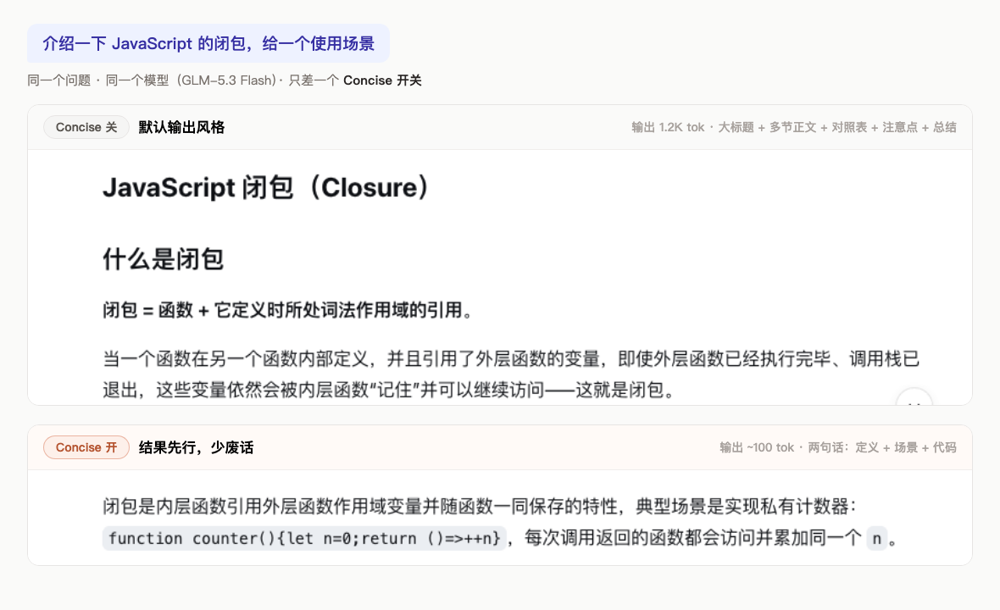
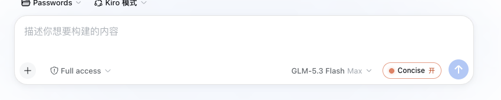

# dsh-concise



Based on Claude Code's built-in **Concise output style** (unchanged upstream since 2.1.258) plus this plugin's own extension, for DeepSeek Harness (dsh): a composer toggle in the zone left of the model picker — hugging the prompt-enhancer button — that makes every reply **lead with results and skip the filler**, while the depth of investigation, verification, and double-checking stays exactly the same. With Concise on, every final reply opens with an engineering-blueprint digest card (intermediate tool-step narration is exempt): 2-3 plain sentences restating the conclusion, select-to-copy, **file paths inside the card are highlighted and click-to-open**, and a deliverables zone at the bottom lists the files this turn actually produced.

[**中文**](README.md) · [Releases](https://github.com/hoyyang/dsh-concise/releases) · [Changelog](CHANGELOG.md)

<p align="center">
  
  
  
  
  
  
</p>

## Install

```sh
dsh plugin add dsh-concise           # npm package (recommended: globally unique id)
# or
dsh plugin add hoyyang/dsh-concise   # GitHub repository
```

**Zero config, works out of the box** — no API keys, no accounts, no settings. Refresh the web UI after install and the toggle appears left of the model picker, hugging the prompt-enhancer button when present. Requires dsh web 0.1.0-rc.8+ (verified).

## Toggle off vs on — same question, same model

Asked the same question in two sessions (GLM-5.3 Flash), differing only by the Concise toggle:



With Concise on you get:

- **The answer is the first sentence** — no "Sure, let me explain…", no preamble, no narration
- **Water is removed, substance is not** — commands, paths, risks, and next steps survive verbatim; what goes is recap, boilerplate closers, decorative sections
- **Work depth unchanged** — investigation, verification, and double-checking happen exactly as before (it is written into the injected prompt)
- **Long sessions save tokens** — the preamble and recaps you skip every turn add up

In one line: **the answer didn't get smaller — the filler is gone.**

## 30-second start

1. Install the plugin, refresh the page
2. Find the prompt-enhancer pill (`✦ 标准/轻量`, dsh-improve-prompt) in the composer tool row — the `● Concise` toggle sits immediately LEFT of it, and the prompt-enhancer itself sits left of the model picker. Without improve-prompt installed, Concise hugs the model picker's left side
3. Click it; the next reply follows the new style. Orange = on, grey = off



The toggle is **per-session**: turning it on here doesn't touch your other sessions (new sessions start off). The **default for new sessions** is editable in the UI: click the **⌃** on the pill to open the settings popover and flip "Default for new sessions" — it is stored as the `default` field in `~/.dsh/dsh-concise/state.json` and applies to every session created afterwards (`defaultEnabled: true` does the same from config).

## Features

- **One-click toggle (collapsed)** immediately left of the prompt-enhancer button (row order: Concise → prompt-enhancer → model picker): only the switch shows by default, pinned against the pill — hover or keyboard focus expands the label leftward with the right edge pinned, never shifting neighboring controls. The pill is split into two independently focusable controls: the **track** switches the current session, the **label + ⌃** opens the settings popover
- **New-session default switch (popover)**: the **⌃** on the expanded pill (or clicking the label) opens a small popover whose "Default for new sessions" row decides whether sessions created later start with Concise on — it is stored as the `default` field in `~/.dsh/dsh-concise/state.json` and shared across sessions. The caret stays visible until the entry has been discovered, and a one-time hint bubble explains it on first use; clicking outside or pressing ESC closes the popover, and ESC returns focus to the caret
- **Plain-language digest card**: with Concise on, EVERY final reply opens with an engineering-blueprint card (intermediate step narration exempt) — faint grid + corner ticks + monospace 1.18em, dark text on light, works in both themes. It restates the conclusion in 2-3 plain sentences, only using facts the body already contains; selecting text inside copies it on mouse-up (header flashes COPIED ✓). The rule is issued unconditionally and re-injected on every model assembly; a tail reminder section and a per-step reminder counter attention decay on very long prompts. Since 0.11.0 the digest writing style fuses caveman × humanizer essentials: the first sentence IS the conclusion, telegraphic density, and no AI-tell filler
- **Deliverables from real tool outputs (0.11.4)**: the `交付物 · FILES` zone at the bottom of the card lists files this turn actually produced — `write`, `present`, `dsh_image_gen`, `draw_code`, HTML-workshop results (both direct tool calls and `run_code`-nested dispatch). It never guesses from prose; every path is existence-checked before rendering, and clicking opens it with the OS default app
- **Clickable in-card paths (0.11.6)**: paths inside the card are coloured with the CSS Custom Highlight API plus a dotted underline; a click hit-test resolves the path and hands it to the host to open. Links get only their `href` repaired (attribute-level)
- **Stable rendering (0.11.6)**: earlier path chips replaced React-owned text nodes, so a later host re-render threw `NotFoundError: removeChild` and permanently abdicated the shared render entry — symptom: **assistant replies vanished in every session until a page reload**. Since 0.11.6 the plugin treats the card as read-only (it only appends its own deliverables zone); reproduced against React 18.3.1: old client crashes, new client stays clean
- **Per-step pre-generation contract reminder (0.11.2)**: via the host `agent/pre-step` channel, a one-line transient digest-contract reminder is appended as the LAST message of every LLM request (not persisted, not in transcripts, zero accumulation; main sessions only) — the measured fix for digest misses on audit-report and table-shaped replies
- **`/concise` command** in the slash menu and CLI sessions: `/concise`, `/concise on|off`, `/concise status` (parity with Claude Code's `/output-style`)
- **Headless/CLI sessions**: style injection and the digest card work there too (without a web server only the local HTTP API degrades — use `/concise`)
- **Custom style**: a non-empty `~/.dsh/dsh-concise/style.md` overrides the built-in style text, effective on the next assembly (parity with `/output-style:new`)
- **Claude's Concise style**: results first, no preamble, no narration, no filler closers
- **Same work depth**: only reporting is compressed — never the rigor
- **Effective on the next turn** via a dynamic system-prompt section (no restart, no session reload)
- **Per-session scope**: the track switch only affects the current session's new replies — sessions stay independent; the default for newly created sessions comes from the popover's "Default for new sessions" switch (or the `defaultEnabled` config)
- **Persistent**: per-session state survives restarts (atomic writes to `~/.dsh/dsh-concise/state.json`)
- **Auto re-sync**: the button polls lightly every 15 s (visible tab only) plus on focus/visibility, so `/concise`, API, or other-tab changes are reflected without reload
- **Clear visual state**: Claude-orange aurora gradient track with breathing glow when on, neutral glass when off; sheen sweep on hover and springy press feedback (all motion off under `prefers-reduced-motion`)
- **Accessible**: the track is a real `role="switch"` with `aria-checked`, the ⌃ entry is a separate `aria-haspopup="dialog"` button (focus returns to it on ESC), zh/en localized tooltips
- **Multi-tab sync** via a custom DOM event
- **Precise placement**: anchors immediately left of the prompt-enhancer entry (`div.dip-root`); without improve-prompt it anchors left of the model button, with graceful degradation when the model seat cannot be found
- **Clean uninstall**: prompt sections, HTTP routes, host command, styles, and client registration are all removed

## Usage

`/concise` from the slash menu (also works in CLI sessions):

```text
/concise          # toggle
/concise on|off   # explicit set
/concise status   # state + style source (built-in / custom)
```

Local API for scripts:

```sh
curl "http://127.0.0.1:3080/dsh-concise/api/state?sessionId=<id>"   # -> {"enabled":true,...}
curl -X POST -H 'content-type: application/json' \
  -d '{"sessionId":"<id>"}' http://127.0.0.1:3080/dsh-concise/api/toggle  # -> {"enabled":false,...}
```

Custom style: put your own text in `~/.dsh/dsh-concise/style.md` to fully replace the built-in style text — saved edits apply from the next model assembly; delete the file to restore the built-in.

## Good fit / Not for

**Good fit:**

- You want conclusions first with less filler, without giving up investigation and verification depth
- You need different output styles per session on the same machine (terse reviews vs. natural writing)
- You want a selectable digest card after every turn, with the turn's files one click away
- You drive headless/CLI automation and want `/concise` or the local API to control the style

**Not for:**

- You want longer tutorials, step-by-step teaching, or complete background explainers — turn the toggle off; this plugin only compresses reporting
- You expect the work itself to be shortened (less checking, less verification) — same-depth work is a hard constraint
- A managed environment where no system-prompt section may be injected at all

## Comparison

| Capability | dsh-concise | Claude Code built-in Concise | "Be concise" in AGENTS.md / CLAUDE.md | dsh-improve-prompt |
| --- | --- | --- | --- | --- |
| Works in DeepSeek Harness (dsh) | Yes | No (Claude Code built-in) | Yes | Yes |
| One-click toggle / next-turn effect | Yes (composer button + `/concise`) | Yes (`/output-style`) | No, edit file and reload | Yes (edits prompt text) |
| Per-session scope | Yes | Yes | No (project/global) | Yes |
| Digest card every reply | Yes (select-to-copy) | No | No | No |
| Clickable in-card paths / deliverables | Yes (0.11.6) | No | No | No |
| Writes into project files | No | No | Yes | No |
| Custom style text | Yes (`style.md`) | Yes | Yes (hand-written) | Yes (prompt template) |

Reference points: Claude Code's built-in Concise output style (unchanged upstream since 2.1.258), project-level AGENTS.md/CLAUDE.md instructions, and dsh-improve-prompt (which changes prompt text, not output style). This plugin does no prompt engineering or rewriting — it constrains expression and produces the digest card.

## How it works

| Layer | Mechanism |
| --- | --- |
| Prompt injection | `systemPrompt.section({ name: 'dsh-concise:style', order: 40 })` with a function-valued `text`; disabled renders as an empty string and is dropped. A second `dsh-concise:reminder` section at order 900 re-states the contract near the tail |
| Per-step reminder | `agent/pre-step` waterfall appends a one-line transient user message after the last message of each LLM request (main sessions only; not persisted) |
| Host command | `commands.register({ name: 'concise' })` — `/concise [on\|off\|status]`, listed in the slash menu automatically |
| Custom style | `$DSH_HOME/dsh-concise/style.md` overrides the built-in text when non-empty; mtime-cached per assembly |
| Toggle API | `webServer.register` prefix route `/dsh-concise/api`: `GET /state`, `POST /toggle`, `POST /set` (loopback only) |
| Turn artifacts | `POST /dsh-concise/api/turn-artifacts` locates the turn by digest text, collects absolute paths from that turn's tool outputs, and returns only files that still exist |
| UI placement | client module anchors in the `conversation.input.right` slot and portals the button left of the prompt-enhancer entry (or left of the model seat when absent), kept in place by a `MutationObserver` |
| Per-session state | `$DSH_HOME/dsh-concise/state.json`: `default` + per-session overrides (500-entry LRU), atomic tmp+rename write |
| Digest rendering | the client upgrades `> **摘要：**` (or legacy `说人话：`) blockquotes into the blueprint card. Since 0.11.6 the card is read-only to the plugin: in-card paths are coloured via CSS Custom Highlight and opened by click hit-testing (`caretPositionFromPoint`), links get only their `href` repaired, and the plugin appends only its own deliverables zone |

## Reliability & verification

- Unit tests: host 12/12, chips + normalize 29/29 (`node --test`, zero dependencies)
- End-to-end prompt proof: with the toggle on, the assembled request carries `Concise output style (active)`; off yields zero hits in the same session
- Session isolation: off -> 0 hits, on -> 1 hit, other sessions and the default untouched
- API matrix: `/state`, `/toggle`, `/set`, unknown path 404 — all asserted
- Custom style end-to-end: the request carries the custom text and zero hits of the built-in text; deleting the file restores the built-in
- `/concise` matrix: toggle / on / off / status all verified in the slash menu
- Digest card assertions (jsdom): only blockquotes prefixed 摘要：/说人话： are upgraded; ordinary quotes untouched; uninstall removes every injected class
- 0.11.6 React A/B: the old client throws `NotFoundError: removeChild` under the same update sequence (the host ErrorBoundary takes over the card); the new client records zero errors
- 0.11.6 real machine: the main instance loaded the new style, digest cards and deliverables zones rendered, and every fold/unfold toggle survived three round trips with zero errors
- Stability: full browser console showed 0 errors and 0 warnings through the verification runs
- Concurrency: state writes are atomic (tmp+rename); multiple instances on one page stay in sync via events

## FAQ

**Does Concise make complex tasks sloppy?**
No. The prompt explicitly keeps "thoroughness unchanged" — investigation, verification, and double-checking still happen; only the reporting is compressed.

**How is this different from writing "please be concise" in AGENTS.md?**
Granularity and scope: this is a per-session toggle you flip at any time, without editing files or reloading; it injects a system-prompt section rather than project instructions, so it does not pollute your project config; and it works with any model.

**Is the toggle global or per-session?**
Per-session. Each session remembers its own state; the default for newly created sessions is a separate switch — the "Default for new sessions" row in the ⌃ popover on the pill (or `defaultEnabled: true` in config) — and new sessions start off by default. The change applies from the next reply in that session only.

**Where does the deliverables zone come from?**
From this turn's real tool outputs (`write`, `present`, `dsh_image_gen`, `draw_code`, HTML-workshop results), not from prose guessing. Every path is existence-checked, so deleted files or example paths in prose are not listed.

**Why does a file path sometimes not open?**
The click tries the absolute path, then the session's cwd candidates, then a basename search for historical sessions; if none resolves, it falls back to copying the path.

**Does dark theme work?**
Yes. Styles use dsh's `--dsw-alias-*` design tokens plus a few translucent brand colours and stay readable in both themes.

## Local build

```sh
git clone https://github.com/hoyyang/dsh-concise.git
cd dsh-concise
npm run build        # compile host + bundle client
npm run typecheck    # dual tsconfig type check
```

Layout:

```text
src/index.ts             host: prompt sections, per-step reminder, state, HTTP API, /concise command
src/client/index.ts      client: slot anchor, toggle, digest card rendering/highlights/deliverables
src/client/chips.ts      path detection, click-to-open, deliverables chip helpers
src/client/normalize.ts  digest link and text normalization
test/                    zero-dependency unit tests (host / chips / normalize)
assets/                  README screenshots and diagrams
```

## License

[MIT](LICENSE)
